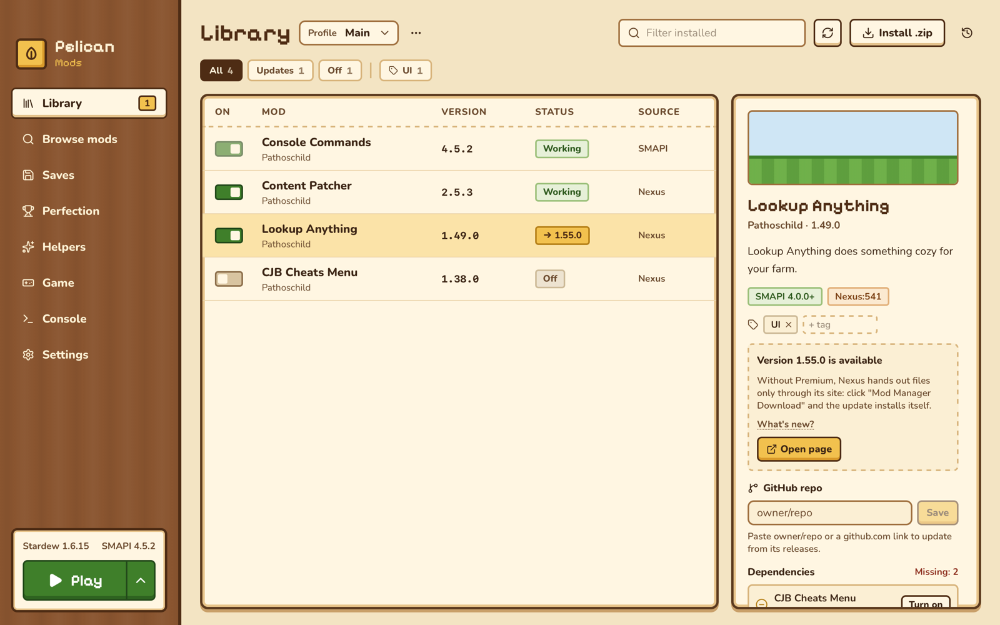
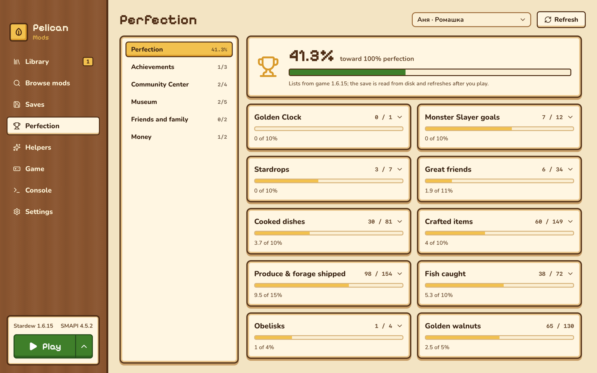
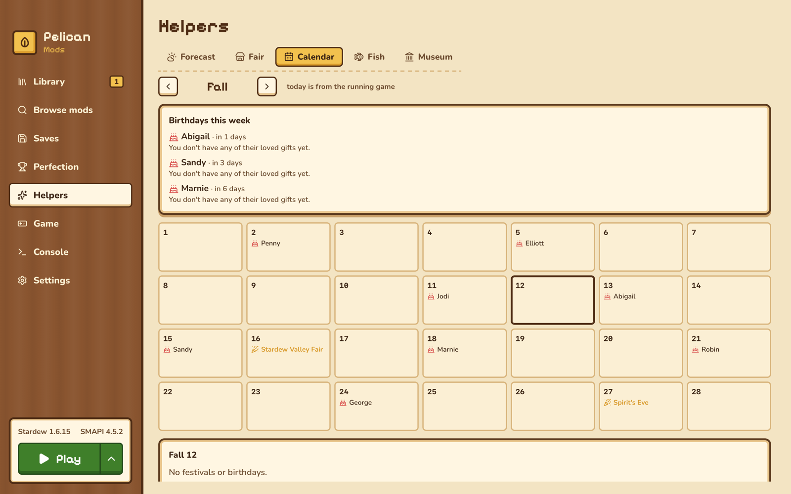
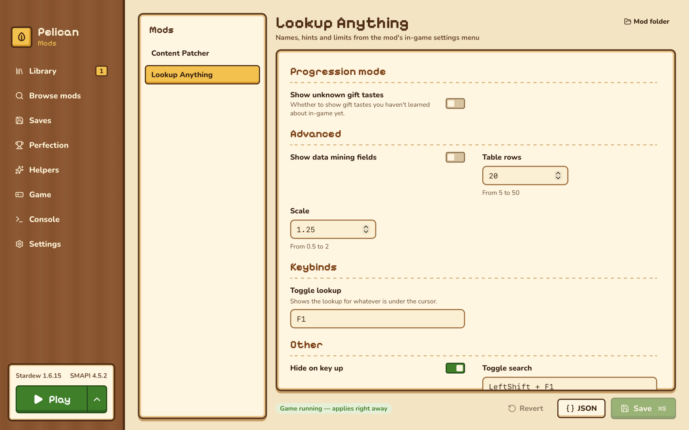
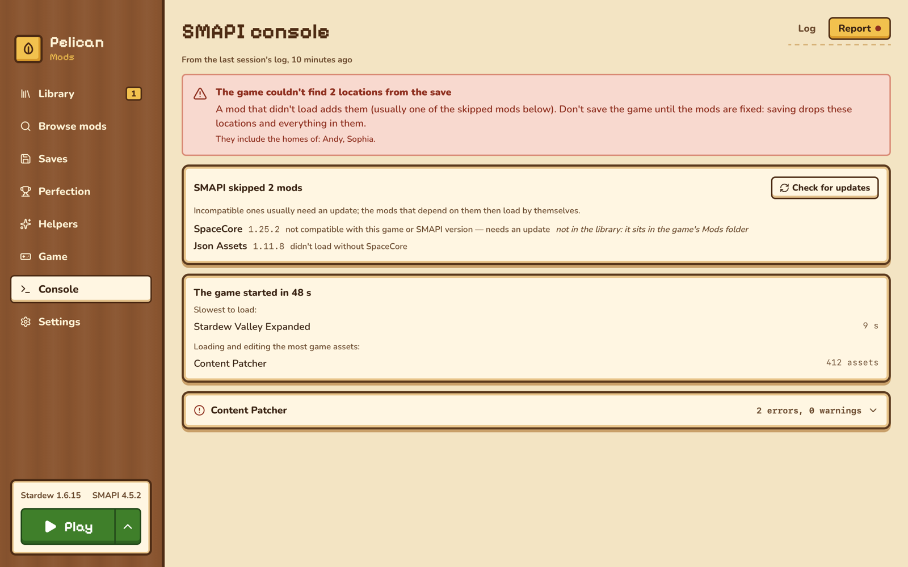

# Pelican Mods

A Stardew Valley launcher and mod manager for macOS. It installs and updates SMAPI and your mods, keeps mod profiles apart, edits mod settings while the game runs, guards your saves, and reads them back to tell you what's left on the way to perfection.



## Features

**Mods**

- Install from a `.zip`, `.7z` or `.rar` dropped on the window, from Nexus Mods (the "Mod Manager Download" button or the built-in catalog), from GitHub releases or from ModDrop.
- Profiles: each is its own set of enabled mods, handed to SMAPI with `--mods-path`, so the game's own `Mods` folder stays untouched and switching is instant.
- Updates through smapi.io for every mod with update keys, plus GitHub repos you attach yourself. GitHub and ModDrop update in place; Nexus does too with Premium, and otherwise opens the right file page.
- Missing and outdated dependencies, mods SMAPI's compatibility list calls broken, and content packs that would fight over the same asset are flagged before you launch.
- History of every install, update and removal, each one undoable; removed mods are set aside, not deleted.
- Tags and filters for big libraries, and mod lists to share a setup or compare it with a co-op host.

**Playing**

- One-click SMAPI install and updates, Rosetta check on Apple Silicon, launch with a live SMAPI console.
- Before launch it warns when the last played save needs mods the profile doesn't have, and offers the profile that save was played with.
- After a session, a report reads the SMAPI log: skipped mods and the update that fixes them, save locations the game dropped, slow and heavy mods, the mod a crash points at.

**Saves**

- A copy before every launch, by hand, and before any restore; optional mirroring to a folder of your own, such as iCloud Drive.
- Export and import saves as `.zip`.

**Progress and helpers**

- A perfection tracker and a full checkup in the spirit of Stardew Checkup: bundles item by item, museum, friendships, collections, quests, Monster Slayer, Ginger Island and more, with names in the game's language and links to the wiki.
- A season plan, a birthday and festival calendar with loved gifts you already own, a fish guide by season, weather and time, a museum helper, and forecasts in the spirit of Stardew Predictor: night events, geodes, mystery boxes, the traveling cart.

**Settings for mods**

- A form for any mod's `config.json`, built from its Generic Mod Config Menu entries or a content pack's schema, with defaults and a reset per field. While the game runs, changes apply without a restart.

The companion mod that ships with the app makes the live parts possible: game state, menu-defined settings and applying them, and the game's own names for everything.

The app speaks the game's twelve languages and follows the game's language by default.

| Progress                                             | Calendar                                                  |
| ---------------------------------------------------- | --------------------------------------------------------- |
|  |  |
| **Mod settings**                                     | **Log report**                                            |
|       |           |

## Install

1. Download the `.dmg` for your Mac from the [latest release](https://github.com/swchck/pelican-mods/releases/latest): `aarch64` for Apple Silicon, `x64` for Intel. macOS 11 or later.
2. Drag Pelican Mods to Applications.
3. The app is signed with its own certificate but not notarized by Apple, so macOS blocks the first launch. Open it once, then go to **System Settings → Privacy & Security** and click **Open Anyway**.

The app finds a Steam or GOG copy of the game by itself and offers to install SMAPI. Later versions arrive through the app's own updater.

To download from Nexus Mods inside the app, add your personal API key under **Settings → Nexus Mods**; it is kept in the macOS Keychain.

## Building from source

You need Node.js, Rust and, for the companion mod, the .NET SDK. The companion compiles against SMAPI in `/Applications/Stardew Valley.app`; without the game, unpack SMAPI's assemblies with `scripts/smapi-refs.sh <dir>` and build with `SMAPI_DIR=<dir>`.

```bash
npm install
npm run companion:build
npm run app:dev
```

`npm run check` runs type checks, lint and unit tests; `npm run test:ui` runs the screen tests in WebKit against a mocked backend. The architecture notes are in [docs/ARCHITECTURE.md](docs/ARCHITECTURE.md), and the changes in [CHANGELOG.md](CHANGELOG.md).

Pelican Mods isn't affiliated with ConcernedApe, Nexus Mods or the SMAPI project.
